# agent-computer-use

Native macOS computer use through a two-tool MCP facade over compact AX-first macos-cua workflows, with the self-contained Samantha GPT Realtime voice runtime.

Portable [Agent Plugin](https://agent-plugins.org/specification). Install: [`AGENTS.md`](AGENTS.md). Collection routing: repo-root `AGENTS.md`.

## Overview

**Purpose.** Lets an agent see and operate native macOS apps. The `agent-computer-use` MCP server exposes two tools: `state` (a compact Accessibility snapshot of one app) and `act` (a batch of actions that presses Accessibility elements first and falls back to pointer and keyboard input, then returns a verified delta). The `macos-cua` skill tells the agent how to use them. Optional: Samantha, a GPT Realtime voice runtime (`runtime/voice-cua/`) that drives the same tools by voice.

**Requirements.** macOS 13 or later (tested on Apple silicon), `python3` on `PATH`, and the CUAService helper app (**Agent Computer Use.app**) installed with **Accessibility** and **Screen Recording** granted. Not supported on Linux or Windows.

**Install.**

1. Install the `agent-computer-use` plugin from this repository's marketplace (`.cursor-plugin/marketplace.json` or `.grok-plugin/marketplace.json`).
2. Install CUAService. Testers use the notarized build from the repository's GitHub release (download the DMG, drag **Agent Computer Use** to Applications, open it). Maintainers can build from source with `python3 skills/macos-cua/service/install_service.py --team <YOUR_TEAM_ID>`. That needs Xcode Command Line Tools and a code-signing identity for that Apple Developer team.
3. Grant Accessibility and Screen Recording to Agent Computer Use (System Settings → Privacy & Security), then relaunch it.
4. Restart the client. The plugin should list exactly two tools, `state` and `act`.

**Configuration.** Nothing is required. `AGENT_COMPUTER_USE_PYTHON` picks the Python interpreter. For voice only, store an OpenAI API key in the macOS login Keychain with the `runtime/voice-cua` secrets CLI. `runtime/voice-cua/config/secret-templates/` holds metadata only (label, Keychain service, account) and never a value.

**Network endpoints and credentials.** `state` and `act` stay on the machine. They talk to the local CUAService process, and nothing is uploaded. The voice runtime, when you turn it on, calls `https://api.openai.com/v1/realtime` (session and WebSocket) with the Keychain OpenAI key. The developer-only benchmark `skills/macos-cua/scripts/bench_jev_act.py` calls `https://ai-gateway.vercel.sh` with your own gateway key. Runtime counters and logs stay local under `~/.cache/macos-cua/`. There is no remote telemetry.

**Testing.** From this directory: `python3 -m unittest skills/macos-cua/tests/test_plugin_package.py skills/macos-cua/tests/test_jev_act.py skills/macos-cua/tests/test_cua_service_health.py`. Live check: ask the agent to "open Calculator and compute 12 × 3 with agent-computer-use". It should call `state` and then `act`, and the display should read 36.

**License.** MIT (repository root [`LICENSE`](../../LICENSE)).

## Package boundary

Cursor MCP loads `.cursor-plugin/mcp.json` (`${CURSOR_PLUGIN_ROOT}/bin/agent-computer-use-mcp`, `cwd` `${CURSOR_PLUGIN_ROOT}`). Portable root `mcp.json` stays `./bin/agent-computer-use-mcp`. `python3 skills/macos-cua/scripts/install_harness.py cursor-plugin` only repairs pre-override cache copies. Details: [`AGENTS.md`](AGENTS.md).

`runtime/voice-cua/` owns Samantha's Python runtime, metadata-only secret templates, unit test, and PyInstaller builder. `skills/macos-cua/service/install_service.py` builds that packaged source into the signed nested `voice-cua.app`; it does not search for a sibling repository or fall back to system Python.

## Benchmarks

Five graded axes, each 0–10. Overall is their unweighted mean. Accuracy and visibility are trust gates, not averaged in.

Measured this session: warm discard then `python3 scripts/run_benchmarks.py --repeat 5 --rate`. File `~/.cache/macos-cua/benchmarks-latest.json` written `2026-08-17T03:42:52Z`. Kept: `seed_snapshot` into asserted plans + Calculator/WhatsApp probes reuse the button/closed tree (floor AX); dropped redundant Calculator post-`app_state`. Rejected: seeding postcondition expects from a pre-mutation tree (false pass on stale display). Model: `skills/macos-cua/references/entry-contract.json` `rating_model`. Do not loosen floors to force a pass.

| | |
| --- | --- |
| Suite overall /10 | **8.0** |
| Rows passing | **4 / 4** |
| Trust-gate zeros | **0** |
| Target overall | **9.5** |

Suite-level graded means: speed 4.8, reliability 9.5, robustness 10.0, efficiency 8.2, context efficiency (`token_efficiency`) 7.5.

### Overall by row (five graded axes)

```mermaid
xychart-beta
    title Overall by row /10
    x-axis [Calculator, Folder, TextEdit, WhatsApp]
    y-axis "Overall /10" 0 --> 10
    bar [9.4, 9.5, 6.5, 6.5]
    line [9.5, 9.5, 9.5, 9.5]
```

### Graded axes /10

```mermaid
xychart-beta
    title Graded axes /10
    x-axis [Calculator, Folder, TextEdit, WhatsApp]
    y-axis "Score /10" 0 --> 10
    bar [7.2, 9.5, 1.7, 1.0]
    bar [10, 8.0, 10, 10]
    bar [10, 10, 10, 10]
    bar [10, 10, 6.0, 6.7]
    bar [10, 10, 5.0, 5.0]
```

Series order: Speed, Reliability, Robustness, Efficiency, Token efficiency.

### Rating table

Accuracy and visibility are gates. Folder visibility is n/a (observe-only). Folder reliability 8.0 is the p95/p50 spread penalty; all five repeats still passed.

| Row | Overall | Speed | Reliability | Robustness | Efficiency | Token | Accuracy | Visibility |
| --- | ---: | ---: | ---: | ---: | ---: | ---: | ---: | ---: |
| Calculator | 9.4 | 7.2 | 10 | 10 | 10 | 10 | 10 | 10 |
| Folder | 9.5 | 9.5 | 8.0 | 10 | 10 | 10 | 10 | n/a |
| TextEdit | 6.5 | 1.7 | 10 | 10 | 6.0 | 5.0 | 10 | 10 |
| WhatsApp | 6.5 | 1.0 | 10 | 10 | 6.7 | 5.0 | 10 | 10 |

### Reliability

`10 * pass_rate`; subtract 2.0 when p95/p50 duration > 1.5. Suite 9.5.

### Robustness

`10 *` fraction of repeats with `measured.robust`. Suite 10.0.

### Context efficiency

Rating key `token_efficiency`. Suite 7.5.

### Speed

Suite 4.8. Binding constraint on TextEdit and WhatsApp.

```mermaid
xychart-beta
    title Speed floor versus p50 seconds
    x-axis [Calculator, Folder, TextEdit, WhatsApp]
    y-axis "Seconds" 0 --> 10
    bar [1.582, 0.358, 1.284, 0.125]
    bar [1.581, 0.377, 6.301, 1.316]
```



Series order: Floor (s), p50 duration (s).

### Efficiency

Suite 8.2. Calculator at floor (`ax_snapshots` 2).
