# agent-computer-use

Native macOS computer use through a two-tool MCP facade over compact AX-first macos-cua workflows, with the self-contained Samantha GPT-Live 1 voice runtime.

Portable [Agent Plugin](https://agent-plugins.org/specification). Install: [`AGENTS.md`](AGENTS.md). Collection routing: repo-root `AGENTS.md`.

## Package boundary

Cursor MCP loads `.cursor-plugin/mcp.json` (`${CURSOR_PLUGIN_ROOT}/bin/agent-computer-use-mcp`, `cwd` `${CURSOR_PLUGIN_ROOT}`). Portable root `mcp.json` stays `./bin/agent-computer-use-mcp`. `python3 skills/macos-cua/scripts/install_harness.py cursor-plugin` only repairs pre-override cache copies. Details: [`AGENTS.md`](AGENTS.md).

`runtime/voice-cua/` owns Samantha's Python runtime, metadata-only secret templates, unit test, and PyInstaller builder. `skills/macos-cua/service/install_service.py` builds that packaged source into the signed nested `voice-cua.app`; it does not search for a sibling repository or fall back to system Python.

## Dynamic Island (island-post)

CUAService (the Agent Computer Use menu bar app) hosts the island from launch, Samantha or not. Menu: **Show Dynamic Island** (default on), **ACU Settings…** (⌘,: the one ACU Settings window — island, Samantha voice, AI agents, Computer Use permissions; also `macos-cua settings [pane]`), Samantha on/off.

**Transports.**
- **Local socket (default for `island-post` and Samantha's helper):** `~/Library/Application Support/CUAService/island.sock`, directory 0700, socket 0600. CUAService checks each peer's uid with `getpeereid()`. The client reads nothing from the Keychain, so macOS never shows a Keychain dialog. CUAService accepts a source once it is set up (ACU Settings → AI Agents → source → **Rotate**; Samantha's is created when you turn her on), and the source's toggle and attention cap still apply.
- **HTTP `127.0.0.1:8777` with `Authorization: Bearer <token>`:** for other harnesses (`island-post --http` too). The token sits in the Keychain (service `samantha.island`, account `samantha`/`grok`/`cursor`/`codex`). The item trusts only CUAService, so reading it with `/usr/bin/security` prompts. Use the socket where you can. Loopback only: `Origin` headers and non-loopback `Host` are rejected. Unsigned requests get 401 unless the local-dev flag `island.hub.allowUnsignedLocalDev` is on (off by default).

A source switched off in AI Agents gets 403. Approval and choice cards also need "Can raise approval cards" and an attention cap of Attention or higher.

```sh
cp bin/island-post ~/.local/bin/   # once
island-post --source grok-bot --kind running --title "Booking table" --app Comet
island-post --source cursor --kind approval --id deploy-1 --title "Deploy to staging?" --detail "3 services" --wait 120
island-post --source grok-bot --kind choice --id q1 --prompt "Which do you prefer?" \
    --option "Looks great=great" --option "Needs work=needs_work" --allow-text --wait 300
island-post --source codex --kind clear --id deploy-1
```

**Choice cards** (`--kind choice`, implied by `--prompt`/`--option`):
- Options: up to 6 `--option label=value`, plus `--multi`, `--allow-text`, `--primary <value>` and `--danger <value>`.
- Compact island: the source icon and one amber mark (a count badge instead when 2+ cards wait). Other sources get one circle each on the left (max 3 + "+N"). With music playing, a choice card shares the pill (Duo: artwork lead, source + mark trail); an approval takes the whole pill.
- Arrival: a soft Tink (ACU Settings → General → Mute agent prompt sound; silent when the source app is frontmost) and a 4 s **Quick Peek** of the card (never key). It re-peeks at +2 min and at T-60 s, max 3, and holds off while the owner is typing in the source chat app. Hovering a peek pins it.
- Opening: a click anywhere on the pill (including the strip above it) opens the card and makes it key: keys 1–6 pick options, Return sends, Shift-Return adds a line, Esc hands focus back. Approval cards still open on their own and jump the queue.
- Card layout: up to 4 option capsules, two per row (more than 4 shows 3 + "More in chat"); multi-select uses checkboxes and a "Submit N" button; the `--danger` option stays neutral until selected and then needs a confirm. The card is 176 or 220 pt and never scrolls.
- Text field (`--allow-text`): "Reply…", grows to 3 lines; an option and text are sent together.
- Answering: the card clears right away; if the owner was in the card, the next one slides in (two ghost layers show more are queued).
- Timeout: choice cards default to 15 min (`--ttl` to change). The last 60 s show an amber countdown ring; on expiry a 4 s "Timed out. Still open in chat" notice appears and the source circle keeps a hollow red ring until the owner opens the agent list or the agent sends `--kind clear`.
- Persistence: pending cards, timed-out notices and recent answers survive a CUAService restart (`island-pending.json`, 0600).
- Events: shown / hovered / clicked (x, y) / opened (via) / answered (via) / expired go to `~/.cache/macos-cua/island-events.jsonl` (ids and counts only — never titles, options or text).

**`--wait N`** (up to 3600 s) long-polls the hub with no busy polling and reconnects across a CUAService restart. It prints one JSON line:

```json
{"ok": true, "id": "q1", "status": "answered", "values": ["great"], "text": "optional typed reply"}
```

Exit codes: 0 answered or approved, 1 denied or dismissed, 2 timeout or expired, 3 rejected or error. The CLI reports "Keychain access was refused or timed out" (HTTP mode) separately from "no token".

**Chat agents: mirror every inline prompt.** When you ask the owner something in chat (question with options, approval, free-text ask), also put it on the island so the owner can answer from any app:

```sh
island-post --source grok-bot --kind choice --id "$ASK_ID" --prompt "…" --option "Yes=yes" --option "No=no" \
    --allow-text --wait 3600 > answer.json &   # background; read answer.json when it exits
# …if the owner answers in chat first:
island-post --source grok-bot --kind clear --id "$ASK_ID"   # removes the card; the waiter exits 1 (dismissed)
```

**HTTP API.** Requests go to `POST /api/island/publish` (Bearer over HTTP, or `{"method","path","query","body"}` JSON lines over the socket):

```json
{
  "source": "grok-bot | cursor | codex",
  "id": "stable id (≤ 80 chars, default \"default\"); re-post to update",
  "kind": "running | needs_you | done | error | approval | choice | clear",
  "title": "required except for clear (≤ 120); choice prompt fallback",
  "prompt": "choice: the question (≤ 160)",
  "options": [{"label": "Looks great", "value": "great"}],
  "multi": false, "allow_text": false, "primary": "", "danger": "",
  "detail": "optional (≤ 200); card subtitle",
  "app": "optional icon app (default Comet / Cursor / Codex)",
  "destructive": false,
  "ttl_s": 600
}
```

- **Rows** expire after `ttl_s` (default 600 s; done/error 30 s). Cards default to 900 s (15 min).
- **Answers:** `GET /api/agent/approval?source=<s>&id=<id>[&wait=N]` (N ≤ 600 per request) returns `{"status": "pending | approved | denied | answered | dismissed | expired | unknown", "values": [...], "text": "..."}`.
- **Samantha:** `source=samantha` posts a full island snapshot (her voice helper does this over the socket).

## Benchmarks

Five graded axes, each 0–10. Overall is their unweighted mean. Accuracy and visibility are trust gates, not averaged in.

Measured this session: warm discard then `python3 scripts/run_benchmarks.py --repeat 5 --rate`. File `~/.cache/macos-cua/benchmarks-latest.json` written `2026-08-17T03:42:52Z`. Kept: `seed_snapshot` into asserted plans + Calculator/WhatsApp probes reuse the button/closed tree (floor AX); dropped redundant Calculator post-`app_state`. Rejected: seeding postcondition expects from a pre-mutation tree (false pass on stale display). Model: `skills/macos-cua/references/entry-contract.json` `rating_model`. Do not loosen floors to force a pass.

| | |
| --- | --- |
| Suite overall /10 | **8.0** |
| Rows passing | **4 / 4** |
| Trust-gate zeros | **0** |
| Target overall | **9.5** |

Suite-level graded means: speed 4.8, reliability 9.5, robustness 10.0, efficiency 8.2, context efficiency (`token_efficiency`) 7.5.

### Overall by row (five graded axes)

```mermaid
xychart-beta
    title Overall by row /10
    x-axis [Calculator, Folder, TextEdit, WhatsApp]
    y-axis "Overall /10" 0 --> 10
    bar [9.4, 9.5, 6.5, 6.5]
    line [9.5, 9.5, 9.5, 9.5]
```

### Graded axes /10

```mermaid
xychart-beta
    title Graded axes /10
    x-axis [Calculator, Folder, TextEdit, WhatsApp]
    y-axis "Score /10" 0 --> 10
    bar [7.2, 9.5, 1.7, 1.0]
    bar [10, 8.0, 10, 10]
    bar [10, 10, 10, 10]
    bar [10, 10, 6.0, 6.7]
    bar [10, 10, 5.0, 5.0]
```

Series order: Speed, Reliability, Robustness, Efficiency, Token efficiency.

### Rating table

Accuracy and visibility are gates. Folder visibility is n/a (observe-only). Folder reliability 8.0 is the p95/p50 spread penalty; all five repeats still passed.

| Row | Overall | Speed | Reliability | Robustness | Efficiency | Token | Accuracy | Visibility |
| --- | ---: | ---: | ---: | ---: | ---: | ---: | ---: | ---: |
| Calculator | 9.4 | 7.2 | 10 | 10 | 10 | 10 | 10 | 10 |
| Folder | 9.5 | 9.5 | 8.0 | 10 | 10 | 10 | 10 | n/a |
| TextEdit | 6.5 | 1.7 | 10 | 10 | 6.0 | 5.0 | 10 | 10 |
| WhatsApp | 6.5 | 1.0 | 10 | 10 | 6.7 | 5.0 | 10 | 10 |

### Reliability

`10 * pass_rate`; subtract 2.0 when p95/p50 duration > 1.5. Suite 9.5.

### Robustness

`10 *` fraction of repeats with `measured.robust`. Suite 10.0.

### Context efficiency

Rating key `token_efficiency`. Suite 7.5.

### Speed

Suite 4.8. Binding constraint on TextEdit and WhatsApp.

```mermaid
xychart-beta
    title Speed floor versus p50 seconds
    x-axis [Calculator, Folder, TextEdit, WhatsApp]
    y-axis "Seconds" 0 --> 10
    bar [1.582, 0.358, 1.284, 0.125]
    bar [1.581, 0.377, 6.301, 1.316]
```



Series order: Floor (s), p50 duration (s).

### Efficiency

Suite 8.2. Calculator at floor (`ax_snapshots` 2).

### Runtime contract

The MCP launcher rejects package/app fingerprint mismatches and stale running
services. Every native RPC also carries the client build identity, so an already
running stale client is rejected after an app update. Build and sync the same candidate, then restart the signed app before
reconnecting the client. `python3 skills/macos-cua/scripts/runtime_contract.py`
checks this without starting or repairing anything. The app version alone is
insufficient: changed contents at the same version also fail.

Run source tests from this plugin with
`python3 -m unittest runtime/voice-cua/tests/test_voice_cua.py`.
Collection validation (`python3 scripts/check.py` from the repo root) uses the
strict runner and rejects zero collected tests and unlisted skips.
